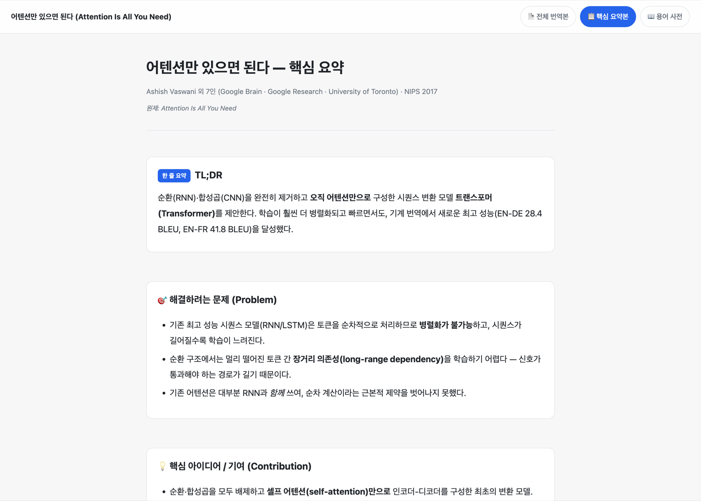
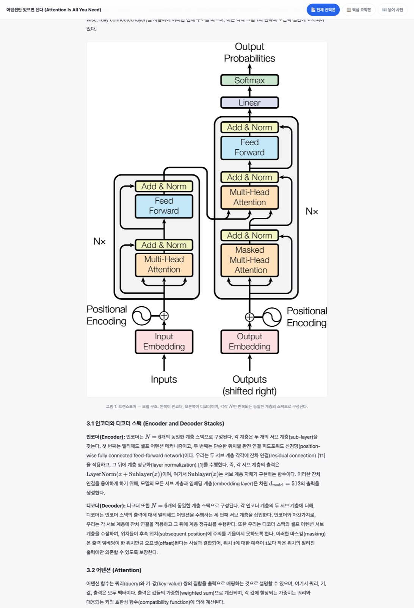
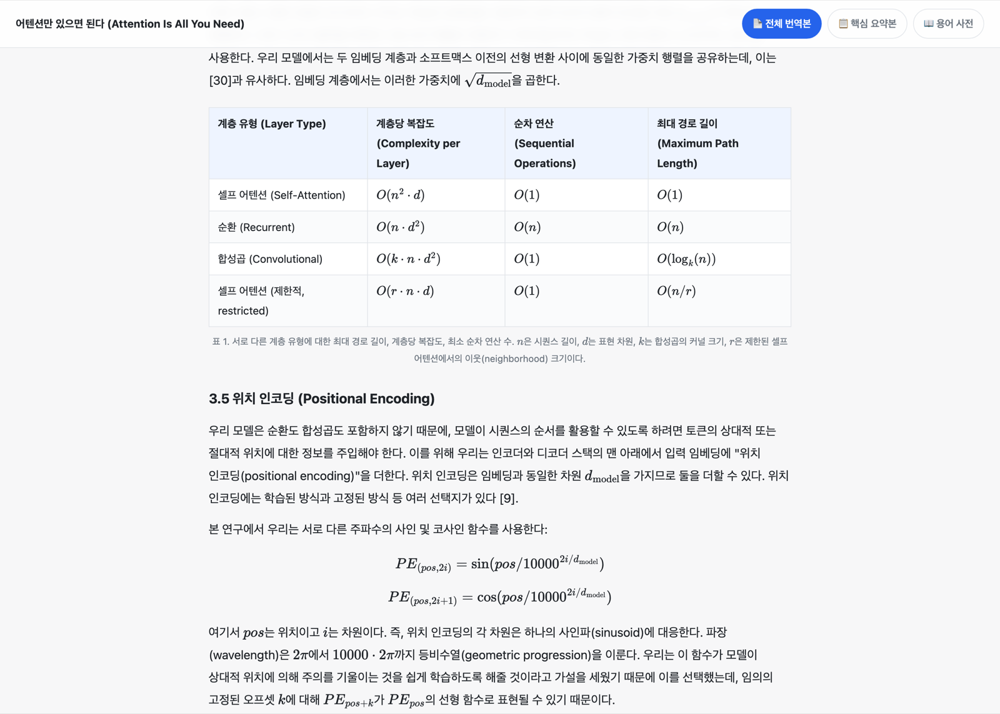
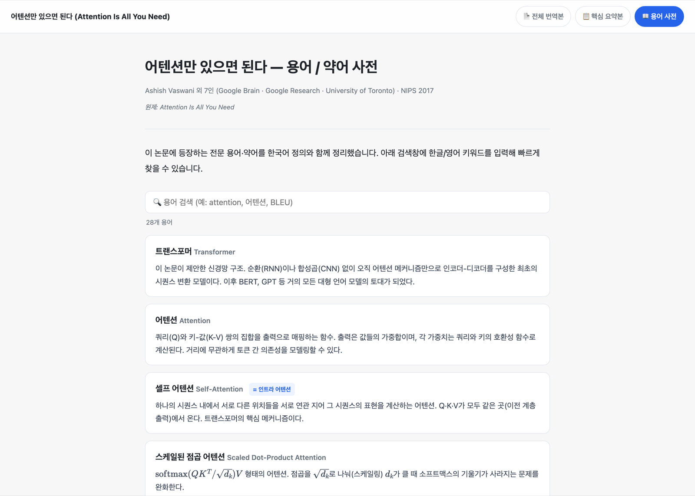
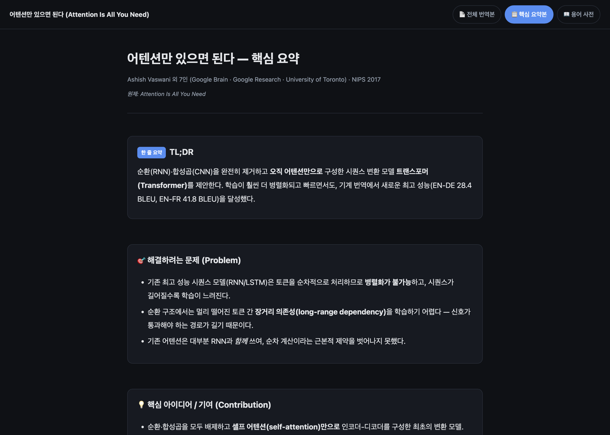
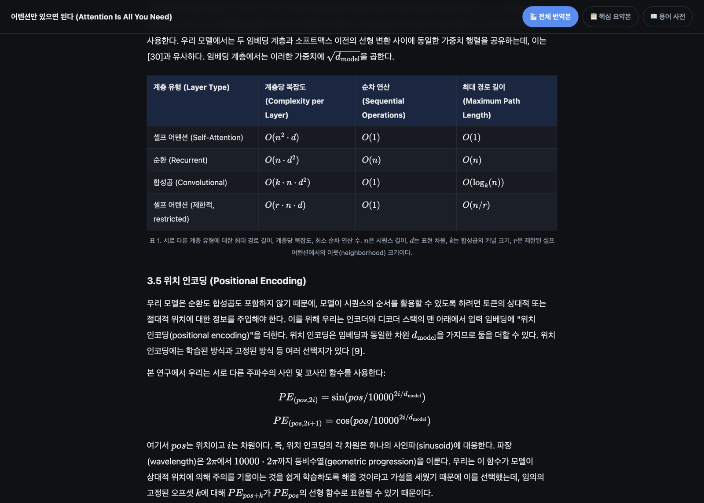

<div align="center">

# 📄 paper-summary

**영어 논문 PDF를 한국어 HTML 문서 3종으로 바꿔주는 Claude Code 플러그인**

전체 번역본 · 핵심 요약본 · 용어 사전 — 그림, 표, 수식을 원문 그대로 옮깁니다.


<br>



<sub>실제 출력 예시 — <i>Attention Is All You Need</i> (Vaswani et al., NIPS 2017) 의 핵심 요약본</sub>

</div>

---

## 왜 쓰나요

논문 PDF를 번역기에 넣으면 레이아웃이 깨지고 그림·표·수식이 사라집니다.
paper-summary 는 PDF에서 **그림을 이미지로 추출하고, 표는 HTML 표로, 수식은 MathJax로** 다시 조판한 뒤
본문을 한국어로 옮깁니다. 결과물은 브라우저에서 바로 읽고, 그대로 PDF로 인쇄할 수 있습니다.

## 무엇이 만들어지나요

| 스킬 | 결과 파일 | 내용 |
|---|---|---|
| `/paper-summary` | **번역본.html** | 논문 전체를 빠짐없이 한국어로. 그림·표·수식·그래프 포함 |
| `/paper-summary` | **요약본.html** | 문제 · 방법론 · 결과 · 결론을 카드로 정리한 핵심 요약 |
| `/paper-summary-word` | **용어사전.html** | 전문 용어·약어를 한국어 정의와 함께 정리 (검색 필터 내장) |

세 문서는 상단 네비게이션으로 **서로 클릭 이동**합니다.
번역은 **음차(영어 발음을 한글로만 옮기기)를 쓰지 않습니다** — `harness`를 "하네스"가 아니라
"제어 장치(harness)"처럼 뜻이 드러나게 옮기고, 같은 용어에는 문서 전체에서 같은 번역어를 씁니다.
모두 **다크 모드**(OS 설정을 따르고, 오른쪽 위 버튼으로 직접 전환·선택 기억)와
**인쇄/PDF 저장**(네비게이션 자동 숨김)을 지원합니다.

조판은 읽기용 학술 문서를 기준으로 잡혀 있습니다 — 한국어 40자 안팎의 본문 폭, 역할이 구분되는
제목 단계, 본문보다 넓게 흐르는 그림·표. 같은 크기 카드를 늘어놓거나 이모지를 아이콘 대신 쓰지
않습니다. 모델은 원고 조각만 쓰고 **조립은 스크립트가 하므로**, 논문이 달라져도 보기는 흔들리지 않습니다.

---

## 실제 사용 예시

### 🧾 핵심 요약본 — 논문을 30초 만에 파악

TL;DR 한 줄 요약부터 문제 정의, 핵심 기여, 방법, 실험 결과, 한계까지 카드로 정리합니다.


### 🖼️ 전체 번역본 — 그림을 원문 그대로

PDF의 도표를 이미지로 추출해 원래 자리에 넣고, 캡션은 한국어로 번역합니다.



### 📐 전체 번역본 — 표와 수식도 그대로

표는 이미지가 아니라 **복사 가능한 HTML 표**로, 수식은 **MathJax**로 렌더링됩니다.



### 📖 용어 사전 — 검색되는 약어 목록

논문에 나오는 전문 용어·약어를 모아 한국어 정의를 붙입니다. 상단 검색창에 한글/영어 어느 쪽을 쳐도 걸립니다.



### 🌙 다크 모드

기본은 OS 테마를 따라갑니다. 상단 네비게이션 오른쪽의 **달/해 버튼**을 누르면
OS 설정과 무관하게 원하는 쪽으로 바꿀 수 있고, 선택은 브라우저에 기억되어 다음에 열 때도 유지됩니다.

<table>
<tr>
<td width="50%"></td>
<td width="50%"></td>
</tr>
</table>

---

## 설치

```text
/plugin marketplace add zoo3323/paper-summary
/plugin install paper-summary@zoo3323
```

플러그인 하나를 설치하면 두 스킬을 모두 쓸 수 있습니다.

## 사용

논문 PDF가 있는 폴더에서 Claude Code 를 열고:

```text
/paper-summary        # 번역본 + 요약본
/paper-summary-word   # 용어/약어 사전 (선택)
```

또는 그냥 이렇게 말해도 됩니다 — *"논문 번역/요약 html 만들어줘"*, *"논문 용어 사전 만들어줘"*.

폴더에 PDF가 여러 개면 어느 것을 처리할지 물어봅니다. 특정 파일을 지정하려면 `/paper-summary 1706.03762.pdf`.

### 결과 폴더 구조

새로 생기는 폴더는 **`korean/` 하나뿐**입니다.

```text
내논문폴더/
├─ 1706.03762.pdf
└─ korean/
   ├─ 번역본.html
   ├─ 요약본.html
   ├─ 용어사전.html      (paper-summary-word 실행 시)
   ├─ images/            ← HTML이 참조하는 그림들
   └─ .work/             ← 숨김. 파인더·ls 목록에 안 보입니다
       ├─ manifest.json
       ├─ fulltext.txt
       └─ src/           ← 번역 원문 (Claude 가 쓴 조각들)
```

> `.work/` 은 지워도 되는 찌꺼기가 **아닙니다.** 번역 원문이 여기 들어 있어서, 지우면
> 오타 하나 고치는 데도 논문을 처음부터 다시 번역해야 합니다.
> 문구를 고치고 싶으면 `.work/src/` 안의 파일을 고친 뒤 조립 명령만 다시 실행하면 됩니다.

`용어사전.html` 은 나중에 따로 만들어도 됩니다. 이미 있는 번역본·요약본의 네비게이션에 용어 사전 탭이 자동으로 끼워집니다. (PDF만 있어도 단독 실행 가능)

---

## 동작 방식

1. `PyMuPDF` 로 PDF에서 본문 텍스트 · 그림 · 벡터 도표를 추출 (`scripts/extract_pdf.py`)
2. 그림은 `korean/images/` 에, 나머지 중간 파일은 `korean/.work/` 으로 격리
3. Claude 가 추출 결과를 읽고 섹션 구조를 유지한 채 한국어로 **원고 조각만** 씁니다
4. `scripts/build_html.py` 가 원고 + 템플릿 + 스타일시트를 조립해 단일 HTML 로 출력

Claude 는 CSS 나 HTML 뼈대를 받아쓰지 않습니다. 그래서 실행이 빠르고, 논문이 달라져도
조판이 흔들리지 않으며, 스타일을 고치면 원고를 다시 조립하는 것만으로 전부 반영됩니다.
결과는 CSS 파일 없이 HTML 하나만 공유해도 그대로 보입니다.

## 요구 사항

- **Claude Code**
- **python3 + [PyMuPDF](https://pymupdf.readthedocs.io/)** — 없으면 스킬이 자동으로 `pip3 install pymupdf` 를 시도합니다 (외부 관리 환경이면 `--user` 폴백).
- 수식 렌더링에 **MathJax CDN** 을 사용하므로 결과 HTML 을 열 때 인터넷 연결이 필요합니다. (오프라인에서는 수식만 렌더링되지 않습니다.)

## 자주 묻는 것

<details>
<summary><b>스캔한 이미지 PDF도 되나요?</b></summary>

텍스트 레이어가 없는 스캔본은 추출 단계에서 본문을 읽지 못합니다. OCR 을 먼저 돌려 텍스트 레이어를 넣은 PDF 를 쓰세요.
</details>

<details>
<summary><b>번역본이 너무 긴데 일부만 볼 수 있나요?</b></summary>

요약본을 먼저 읽고, 상단 네비게이션에서 필요한 부분만 전체 번역본으로 넘어가 확인하는 흐름을 권장합니다. 세 문서는 서로 연결돼 있습니다.
</details>

<details>
<summary><b>결과를 PDF로 저장하고 싶어요</b></summary>

브라우저에서 `⌘P` / `Ctrl+P` 로 인쇄하면 됩니다. 인쇄용 스타일이 들어 있어 네비게이션은 자동으로 빠지고, 표·그림이 페이지 중간에서 잘리지 않게 처리됩니다.
</details>

<details>
<summary><b>스크린샷의 논문은 뭔가요?</b></summary>

Vaswani et al., *Attention Is All You Need* (NIPS 2017, [arXiv:1706.03762](https://arxiv.org/abs/1706.03762)) 를 이 플러그인으로 처리한 실제 결과물입니다.
</details>

---

<div align="center">
<sub>Made for reading papers faster. Issues & PRs welcome.</sub>
</div>
